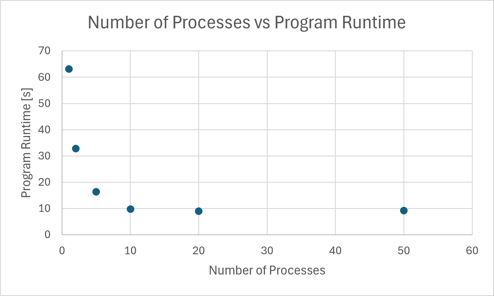

# Lab11_Multiprocessing
Author: Blake Ackland
Course: CPE2600 - 131
Instructor: Dr. Turney
Assignment: Lab 11 - Multiprocessing

Last Update to README:

11/18/2026 by Blake Ackland

## Description of Program:
This project generates a zoom movie of the Mandelbrot set using multiple processes. It has two programs:

* 'mandel': the provided program. It creates a Mandelbrot image in JPEG format based on command-line options (x, y, s, m, etc.).
* 'mandelMovie': a new program that uses 'fork()' and 'execv()' to launch 'mandel' once per frame, with the scale shrinking each frame to "fly" into the set. The number of frames computed at the same time is set from the command line.

## Build Instructions:
This project provides a Makefile that builds both programs. To build in Ubuntu, simply type 'make'. The JPEG development library is required: 'sudo apt install libjpeg-dev'.

To build without the Makefile, run these commands (the programs must be built separately because each has its own 'main'):

* **mandel**: gcc -Wall mandel.c jpegrw.c -o mandel -ljpeg
* **mandelMovie**: gcc -Wall mandelMovie.c -o mandelMovie -lm

To remove the '.d' and '.o' files and both executables, type 'make clean'.

## Run Instructions:
After the program is built, it is ready to run. First, user must generate frames for movie using command './mandelMovie -p <processes>'.For example, './mandelMovie -p 5' computes up to 5 frames at a time. If '-p' is not given, 1 process is used. './mandelMovie -h` displays a summary of usage.

Next, build the movie. This step requires 'sudo apt install ffmpeg'. Run 'ffmpeg -i mandel%d.jpg mandel.mpg' to create an mpg video of all 50 images.

To create a single image with the original 'mandel' program, run command of form './mandel -x 0.286932 -y 0.014287 -s .0005 -m 1000' or run './mandel -h' for more run options

## Program Commands:
**mandelMovie**

* '-p <processes>': Maximum number of child processes running at once (default 1)
* '-h': Show help text

**mandel**

* '-x <coord>': X coordinate of image center (default 0)
* '-y <coord>': Y coordinate of image center (default 0)
* '-s <scale>': Scale of the image on the X axis (default 4)
* '-W <pixels>': Image width in pixels (default 1000)
* '-H <pixels>': Image height in pixels (default 1000)
* '-m <max>': Maximum iterations per point (default 1000)
* '-o <file>': Output file (default mandel.jpg)
* '-h': Show help text

## Program Limitations:
* The number of frames is set by 'NUM_IMAGES' (currently 50) in 'mandelMovie.c', not on the command line.
* 'mandelMovie' expects the 'mandel' executable to be in the current directory ('./mandel').
* Frames are written to the current directory as 'mandel%d.jpg' and overwrite existing files of the same name.
* A misinput '-p' value is treated as 0 and corrected to 1. Values below 1 are also set to 1.

## Program Report
### Briefly describe your implementation: 
The parent loops over the frames, forks a child for each, and the child runs `execv("./mandel", args)` with a scale computed geometrically from the initial scale to the final scale. The parent tracks the number of active children, calls `wait()` when the limit is reached, and waits for all remaining children before exiting.>

### Graph
Runtime to generate all 50 frames, measured for 1, 2, 5, 10, 20 & 50 children processes:

### Discussion of Results
According to the graph, increasing the number of processes does not always mean the program will be faster. The result from 1-2 and 2-5 processes is about double the speed, but after that the addition of more processes reaches a point of diminishing returns. The jump from 5-10 processes is slightly under 1/2 reduction, and after that the program plateaus around 9.5 seconds.